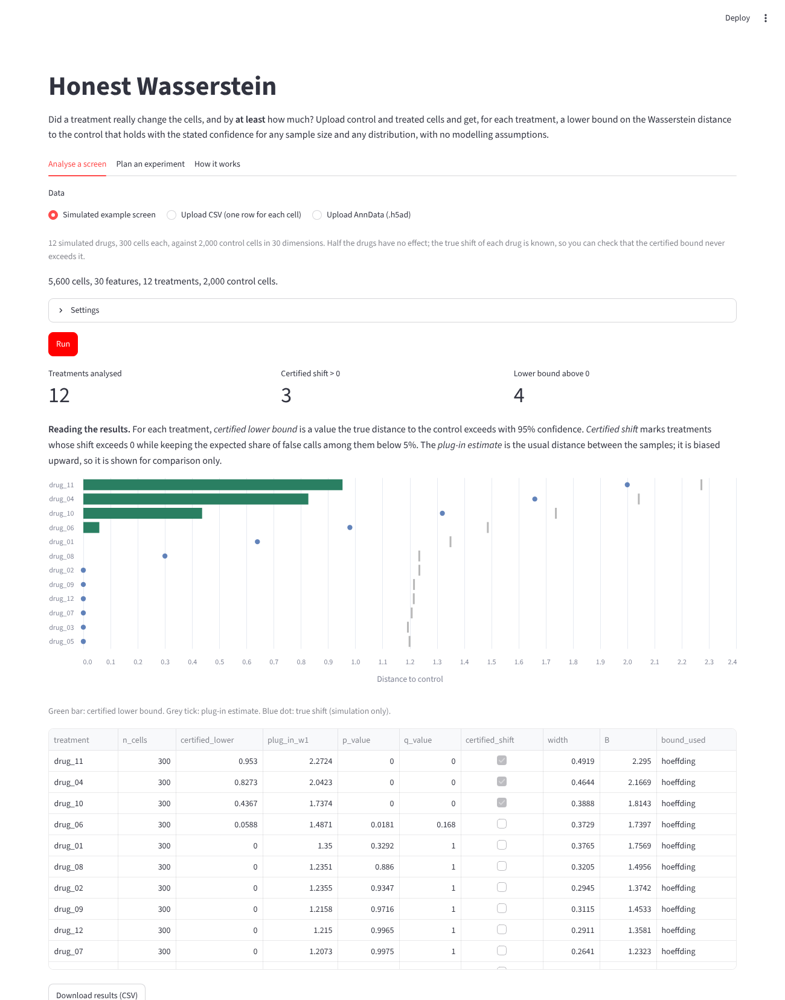

# Honest Wasserstein

**Did a treatment really change the cells, and by at least how much?**

`honestw` compares groups of cells, for example drug-treated and control cells from a
single-cell RNA sequencing or flow cytometry screen, and reports for each treatment a
**certified lower bound** on how far it moved the cells. The bound holds with the stated
confidence for every sample size and every distribution, with no modelling assumptions.

It implements the methods of

> S. Kar. *Honest finite-sample inference for Wasserstein distances in general dimension.*
> [doi:10.2139/ssrn.7620318](https://doi.org/10.2139/ssrn.7620318)

## Why

* With thousands of cells, standard two-sample tests call almost every treatment
  significant, even when the change is negligible, so they cannot rank real hits.
* The Wasserstein distance between two samples, often used to measure the size of a
  shift, is biased upward in high dimension. In the paper's simulations, bootstrap
  intervals around it had 0% coverage in 5 or more dimensions.

`honestw` answers a different question: not "are the groups different?" but "is the
shift **at least** L?", with a finite-sample guarantee.

On the included simulated screen (12 drugs, half with no effect, 30 dimensions):

| | certified lower bound | plug-in estimate |
|---|---|---|
| treatments where the value exceeds the true shift | **0 of 12** | 12 of 12 |
| no-effect treatments called as hits | **0 of 6** | — (all ≈ 1.1) |
| real effects ≥ 1.3 detected | 3 of 3 | |



## Install

```bash
git clone https://github.com/Sangsidhya/honest-wasserstein.git
cd honest-wasserstein
pip install -e ".[app]"
```

## Web app

```bash
streamlit run app/streamlit_app.py
```

Upload a CSV (one row for each cell, one column naming its group) or an AnnData `.h5ad`
file, choose the control group and press **Run**. A simulated example screen is built in,
so the app can be tried without data. Results can be downloaded as CSV. The **Plan an
experiment** tab estimates how many cells are needed to certify a shift of a given size.

The app can be hosted free on [Streamlit Community Cloud](https://streamlit.io/cloud):
point it at `app/streamlit_app.py` in your fork; `requirements.txt` lists the dependencies.
Large screens are better run locally with the Python package.

## Python

```python
import honestw as hw

# Two samples: rows are cells, columns are features (e.g. principal components)
res = hw.lower_bound_w1(treated, control, alpha=0.05)
print(res.lower)        # W1(P, Q) >= res.lower with probability >= 0.95

# A whole screen
X, labels, truth = hw.simulate_screen()           # or hw.load_h5ad(path, "perturbation")
table = hw.run_screen(X, labels, control="control", n_components=20)
print(table[["treatment", "certified_lower", "plug_in_w1", "q_value", "certified_shift"]])

# Upper bound, when values lie in a range known in advance (e.g. a cytometer's range)
ub = hw.upper_bound_w1(treated, control, D=known_diameter)

# Planning: treated cells needed to certify a shift of 0.5
hw.cells_needed(shift=0.5, B=2.0, n_control=2000, captured=0.5)
```

## How it works

1. Every cell is assigned at random to a **training** half or a **held-out** half.
2. If principal components are used, they are fitted on training cells only.
3. For each treatment, the optimal transport problem between the training cells is solved
   (with [POT](https://pythonot.github.io/)). Its dual solution gives the 1-Lipschitz function
   f(z) = min_j { ‖z − y_j‖ − v_j } (eq. 2 of the paper), centred and clipped at a level B
   chosen from the training cells.
4. On held-out cells, the mean of f over treated cells minus its mean over control cells,
   minus a Hoeffding or empirical Bernstein term, is a lower confidence bound on the
   Wasserstein-1 distance (Theorem 4.3, Remark 4.6a). The learned function only affects
   how tight the bound is, never whether it is valid. By default the narrower of the two
   terms is chosen using the training cells only (Hoeffding for small groups, Bernstein
   for large ones), so the choice does not affect the guarantee.
5. Inverting the bound gives a p-value for "shift > δ". All treatments share the control
   cells, so the Benjamini–Yekutieli procedure, valid under any dependence, controls the
   false discovery rate across the screen.

Projecting onto principal components fitted on the training half is an orthogonal
projection, which can only shrink distances. A lower bound in that space is therefore
also a lower bound on the distance between the original high-dimensional distributions.

The upper bound (Theorem 5.3) uses all cells and needs the diameter D of a value range
fixed before looking at the data. It is offered only when no projection is fitted.

## Limits

* Splitting the cells costs power: with a few hundred cells for each treatment, only
  strong effects are certified. This is the price of a guarantee that always holds; the
  planning tool makes it explicit.
* The distance is measured over all features together (or over principal components). It
  tells you whether and how much a treatment moved the cells, not which genes changed;
  use differential expression for that.
* The transport solve uses at most `max_train` training cells (default 3000) for speed.
  Subsampling loosens the bound but keeps it valid.
* Upper bounds in many dimensions are wide; this follows from the lower limits proved in
  the paper (Section 7) and is not a weakness of the implementation.

## Repository

```
honestw/            the package
  bounds.py         lower and upper bounds, p-values
  screen.py         whole-screen analysis with false discovery control
  preprocess.py     splitting and projection
  planning.py       cells needed for a given shift
  data.py           CSV and AnnData loading, simulated screen
app/                Streamlit web app
examples/           runnable example
tests/              tests, including coverage checks
```

Run the tests with `pytest`.

## Citation

If you use this software, please cite the paper above.

## Licence

MIT
